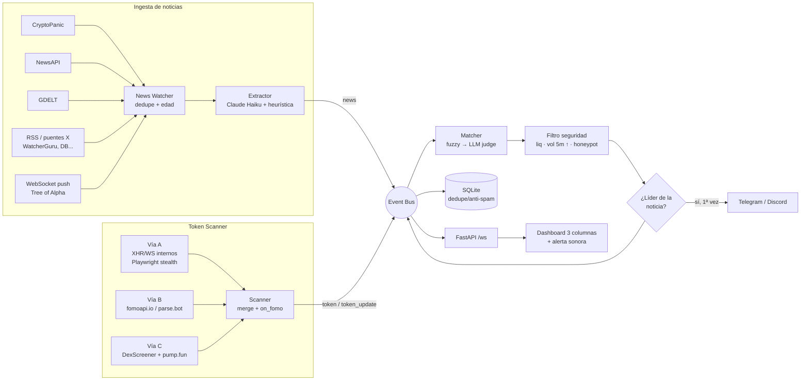

# News-to-Token Signal Radar · fomo.family

Bot y visor de señales: detecta noticias virales o de último momento, encuentra la memecoin que se
lanza sobre esa narrativa en `fomo.family`, verifica liquidez/volumen/honeypot y te alerta en
segundos por **Telegram / Discord** y en un **dashboard en vivo**.

> ⚠️ Herramienta de análisis, no consejo financiero. Las memecoins recién lanzadas son extremadamente
> volátiles y la mayoría van a cero. Los filtros reducen el riesgo pero no lo eliminan.

```bash
pip install -r requirements.txt
python -m radar --demo          # simulación offline → http://localhost:8000
cp .env.example .env            # luego rellena claves y elige vías
python -m radar
```

---

## 1. Arquitectura

**Stack elegido:** Python 3.10+ · `asyncio` · FastAPI/uvicorn · httpx · websockets · SQLite (WAL) ·
rapidfuzz · SDK oficial de Anthropic (Claude Haiku) · Playwright (opcional).

Python + asyncio es aquí más robusto que Node porque todo el trabajo es I/O concurrente (decenas de
polls/WS simultáneos). Además, el ecosistema de scraping (Playwright), NLP/fuzzy (rapidfuzz, C++) y
los SDKs de LLM son de primera clase. Un único proceso basta para cientos de eventos por segundo.

Arquitectura **event-driven**: cada módulo publica en un bus pub/sub en memoria y no conoce a los demás.



### Flujo de datos paso a paso

1. **Ingesta.** Cada fuente se consulta cada `NEWS_POLL_SECONDS`, o recibe push por WebSocket.
   Cada titular se normaliza y se convierte en un `sha1`. Así, la misma noticia publicada por varias
   fuentes se procesa una sola vez, primero en memoria y luego en SQLite, que sobrevive a reinicios.
   Las noticias más viejas que `NEWS_MAX_AGE_MINUTES` se descartan.
2. **Extracción de entidades.** Claude Haiku (`claude-haiku-5-5`, `effort: low`, salida JSON con
   esquema estricto) devuelve `keywords`, `potential_tickers`, `narrative` y `meme_potential`.
   En paralelo corre una **heurística determinista**: nombres propios, cifras+unidad (`1 cent` → `1CENT`),
   cashtags, frases entre comillas y combinaciones sujeto+gancho (`TRUMPPENNY`, `TPENNY`). Ambas listas
   se fusionan, así que el sistema funciona aunque no haya API key o el LLM falle.
3. **Escaneo de tokens.** Las vías A/B/C activas (`FOMO_MODES=a,c`, por ejemplo) devuelven JSON
   heterogéneo. Un normalizador lo convierte en `TokenInfo` (`name, symbol, token_address, chain,
   market_cap, liquidity_usd, volume_5m, holder_count, created_at, fomo_url`). Si el mismo token llega
   por varias vías, se fusiona, y si una de ellas es A o B se marca `on_fomo=True`.
4. **Cruce (matching)**, en ambos sentidos: un token nuevo se compara con las noticias de las últimas
   `NEWS_WINDOW_HOURS`, y una noticia nueva con los tokens recientes, porque a veces el token se crea
   antes de que la noticia llegue a tus fuentes.
   - **Pre-filtro fuzzy** (Levenshtein, rapidfuzz): ticker vs. tickers potenciales, cobertura de
     palabras del nombre en keywords/titular y símbolo dentro del titular. Una sola palabra
     compartida (p. ej. solo "Trump") se penaliza.
   - Los pares con fuzzy ≥ `FUZZY_PREFILTER` pasan al **juez LLM**, en un solo request por token con
     hasta 8 noticias: *"¿Este token recién creado hace referencia directa a esta noticia? Score 0-100
     + justificación en 1 línea"*.
   - `match_score = 0.7·LLM + 0.3·fuzzy`. Sin LLM, se usa solo el fuzzy.
5. **Filtro anti-scam** (solo si `match_score ≥ MATCH_THRESHOLD`):
   - Las métricas se refrescan con DexScreener (par con más liquidez).
   - Liquidez ≥ `MIN_LIQUIDITY_USD`.
   - Volumen 5m ≥ `MIN_VOLUME_5M` y **creciendo** según el historial de snapshots. Si aún no hay
     historial, se usa presión compradora (buys ≥ sells) como proxy.
   - **Honeypot.** En Solana se usa RugCheck: *freeze/mint authority* activas o riesgos "danger" ⇒
     descarte definitivo. En EVM (Base/ETH/BSC) se usa honeypot.is, que simula una venta, y un sell
     tax ≥ 50 % ⇒ descarte. Si el proveedor no responde pero hay ventas reales en los últimos 5 min,
     se acepta con aviso. Con `HONEYPOT_POLICY=strict` se bloquea.
   - Si no pasa por liquidez o volumen, queda en **watch** y se re-evalúa cada `RECHECK_SECONDS`
     durante `RECHECK_MINUTES`.
6. **Selección del ganador.** Por cada noticia suelen salir ~10 monedas basura. Solo se alerta la
   **líder** (la primera que pasa los filtros). Otra moneda de la misma noticia solo vuelve a
   alertar ("🔁 nuevo líder") si tiene ≥ `LEADER_SWITCH_RATIO`× su liquidez. El resto queda como
   *secundaria* en el dashboard.
7. **Anti-spam.** La tabla `alerts` usa la clave `chain:address` y un `INSERT OR IGNORE` atómico:
   un token nunca se alerta dos veces, ni tras reiniciar el proceso.
8. **Entrega.** La alerta va a Telegram (botones *Comprar en Fomo*, *DexScreener*, *Copiar CA* nativo
   y *Noticia*) y a Discord (embed + `@here`). Todos los eventos se emiten por `/ws` al dashboard.

## 2. Estructura de carpetas

```
.
├── radar/
│   ├── __main__.py            # CLI: python -m radar [--demo]
│   ├── app.py                 # ensamblado + supervisión de tareas + estado para el dashboard
│   ├── config.py              # Settings desde env/.env
│   ├── models.py              # NewsItem, TokenInfo, SafetyReport, Signal (pydantic)
│   ├── bus.py                 # Event bus pub/sub asyncio
│   ├── storage.py             # SQLite: dedupe noticias, tokens, alerts (anti-spam), signals
│   ├── llm.py                 # Claude Haiku: extracción + juez (structured outputs)
│   ├── demo.py                # escenario simulado "Trump Penny"
│   ├── news/
│   │   ├── base.py            # contratos Polling/Streaming
│   │   ├── sources.py         # CryptoPanic, NewsAPI, GDELT, RSS, WebSocket genérico
│   │   ├── extractor.py       # LLM + heurística de tickers
│   │   └── watcher.py         # orquestador de ingesta
│   ├── fomo/
│   │   ├── base.py            # TokenSource + normalizador JSON→TokenInfo
│   │   ├── via_a_network.py   # Vía A: HTTP / WS internos / Playwright stealth
│   │   ├── via_b_wrapper.py   # Vía B: wrappers de terceros
│   │   ├── via_c_onchain.py   # Vía C: DexScreener + pump.fun
│   │   └── scanner.py         # orquestador de vías
│   ├── onchain/
│   │   ├── dexscreener.py     # métricas de pares
│   │   └── security.py        # RugCheck (Solana) / honeypot.is (EVM)
│   ├── matcher/
│   │   ├── fuzzy.py           # pre-filtro Levenshtein
│   │   ├── safety.py          # liquidez, tendencia de volumen, honeypot
│   │   └── engine.py          # cruce, decisión de líder, re-chequeo
│   ├── alerts/
│   │   ├── formatter.py       # mensajes Telegram (HTML) / Discord (embed)
│   │   └── dispatcher.py      # envío con reintentos
│   └── api/server.py          # FastAPI: /, /ws, /api/snapshot, /api/signals, /health
├── web/index.html             # dashboard (HTML+JS sin dependencias, tema terminal)
├── tools/capture_fomo_network.py  # descubre endpoints de fomo.family (Vía A)
├── docs/FOMO_NETWORK_INSPECTION.md
├── tests/test_core.py
├── .env.example · requirements.txt · pyproject.toml
```

## 3. Puesta en marcha

```bash
python -m venv .venv && source .venv/bin/activate
pip install -r requirements.txt
cp .env.example .env
```

Configuración mínima recomendada:

```env
ANTHROPIC_API_KEY=sk-ant-...
CRYPTOPANIC_TOKEN=...                 # y/o NEWSAPI_KEY, RSS_FEEDS, WS_NEWS_URL
FOMO_MODES=c                          # empieza con on-chain; añade "a" cuando tengas el endpoint
TELEGRAM_BOT_TOKEN=123:ABC...
TELEGRAM_CHAT_ID=123456789
```

```bash
python -m radar                       # dashboard en http://localhost:8000
python -m pytest -q                   # tests
```

### Telegram con sonido de prioridad
1. Crea el bot con **@BotFather** y copia el token. Escríbele `/start`.
2. Obtén tu `chat_id` con `https://api.telegram.org/bot<TOKEN>/getUpdates`, o usa un grupo/canal
   con el bot como admin.
3. Las alertas se envían con `disable_notification=false`. Telegram no permite que un bot imponga un
   tono, así que en la app abre el chat del bot → **Notificaciones → Sonido** y elige uno distintivo,
   y añádelo a las excepciones de "No molestar" del sistema.
4. `<code>CA</code>` se copia con un toque, y el botón **📋 Copiar CA** usa `copy_text` (Bot API 7.11+).

### Vía A / B / C
- **A**: ver [`docs/FOMO_NETWORK_INSPECTION.md`](docs/FOMO_NETWORK_INSPECTION.md) o ejecutar
  `python tools/capture_fomo_network.py`. Con Cloudflare, usa `FOMO_A_PLAYWRIGHT=true` y
  `pip install playwright && playwright install chromium`.
- **B**: pon en `FOMO_B_URL` la URL exacta del endpoint de listado según la doc del proveedor
  (`{category}` → `FOMO_B_CATEGORY=Memes`) y su clave. El normalizador autodetecta los campos.
- **C**: funciona sin configuración. Con `FOMO_MODES=a,c` y `REQUIRE_ON_FOMO=true` solo alertan los
  tokens que aparecen **a la vez** on-chain y en fomo.family.

## 4. Afinar
| Síntoma | Ajuste |
|---|---|
| Demasiados falsos positivos | sube `MATCH_THRESHOLD` (85-90) o `MIN_LIQUIDITY_USD`; usa `HONEYPOT_POLICY=strict` |
| Llegas tarde | baja `FOMO_POLL_SECONDS`, usa WS (Vía A / `WS_NEWS_URL`), `REQUIRE_VOLUME_GROWTH=false` |
| Coste LLM | sube `FUZZY_PREFILTER`; el juez ya agrupa hasta 8 noticias por llamada |
| Sin API key | funciona solo con heurística + fuzzy (menos preciso con juegos de palabras) |

## 5. Limitaciones conocidas
- Los endpoints internos de fomo.family y de los wrappers no son públicos y pueden cambiar. Por eso
  la Vía A/B es 100 % configurable y la Vía C sirve de red de seguridad.
- El formato de URL de token de fomo.family (`FOMO_TOKEN_URL_TEMPLATE`) debe verificarse
  (ver docs, §7).
- `holder_count` no viene en DexScreener. Se completa con RugCheck/honeypot.is o con la Vía A/B.
- SQLite + bus en memoria = un solo proceso. Para escalar horizontalmente, sustituye `bus.py` por
  Redis Streams y `storage.py` por Redis/Postgres. Las interfaces están aisladas para ello.
